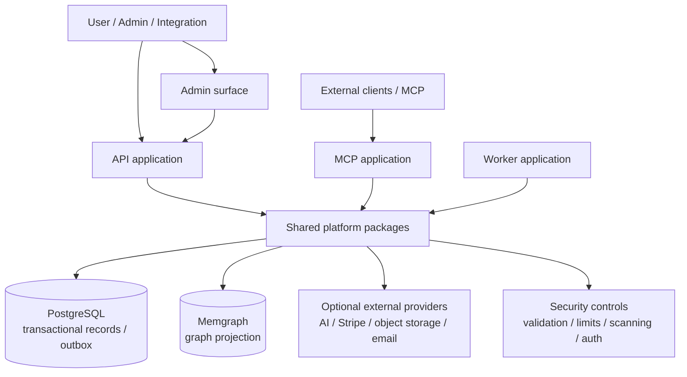

<a id="readme-top"></a>

<div align="center">

# VirgoScorpio Hub

**A modular Node.js application platform designed to augment human capability through secure, governed human-AI collaboration.**

[](package.json)
[](vendor/enginex/package.json)
[](https://github.com/GoldenObsidianLLC/VirgoScorpio-Hub/actions/workflows/ci.yml)
[](LICENSE)
[](https://nodejs.org/)

[Overview](#overview) · [Capabilities](#capabilities) · [Quick start](#quick-start) · [Architecture](#architecture) · [Documentation](docs/README.md) · [Change record](change.md) · [Governance](GOVERNANCE.md) · [Code of Conduct](CODE_OF_CONDUCT.md) · [Contributors](CONTRIBUTOR_RECOGNITION.md) · [Contributing](CONTRIBUTING.md) · [Security](SECURITY.md) · [Research & Collaboration](RESEARCH_COLLABORATION.md)

</div>

> **Project status - 22 November 2026 (F1.68 latest merged runtime):** VirgoScorpio Hub 0.6.2 remains private, unreleased and not production-certified. F1.68 password-login timing-oracle hardening merged through [PR #296](https://github.com/GoldenObsidianLLC/VirgoScorpio-Hub/pull/296) at main SHA c4c5fb6328d2747d1d9b9c43aab70fc93d4eb96e; F1.67 / PR #293 remains the prior merged runtime increment. Exact-main [workflow #45099497274](https://github.com/GoldenObsidianLLC/VirgoScorpio-Hub/actions/runs/45099497274) passed 7/7 jobs, including Node 22/24, live PostgreSQL/Memgraph integration, browser smoke, CodeQL, signed lockfile/SBOM attestation and exact-source evidence consolidation. Canonical mainline readiness [artifact #14784563967](https://github.com/GoldenObsidianLLC/VirgoScorpio-Hub/actions/runs/45099497274/artifacts/14784563967) remains 8 PASS / 2 PARTIAL / 14 MISSING_EVIDENCE, NOT_PRODUCTION_CERTIFIED / NO-GO. F1.68 adds uniform dummy scrypt work for unknown/malformed login hashes; oversized/non-string candidates cannot authenticate. No SemVer change or production authorization is implied. See the [22 November release-gate report](docs/reports/2026-11-22-VirgoScorpio-Hub-0.6.2-Release-Gate-Report.md).
> **Recent security hardening:** F1.64 revalidates community moderation authorization inside the write transaction; F1.65 enforces confidential classification for non-mock AI providers; F1.66 rechecks the WebSocket document-specific edit grant after awaited hub reauthorization and immediately before join/snapshot delivery. See the [F1.64-F1.66 report](docs/reports/2026-11-22-F1-64-66-SECURITY-HARDENING-REPORT.md).
> **Aikido audit and assurance:** The [20 November aggregate triage report](docs/reports/2026-11-20-AIKIDO-SECURITY-AUDIT-TRIAGE-REPORT.md) remains a historical vendor snapshot. Individual scanner fingerprints still need to be exported and mapped before any record is called resolved; issues #234/#235/#277 remain open. Independent tenant review #14, qualified dependency/license review #23 and platform security assessment #25 remain separate gates.
> **Release boundary:** No release tag, GitHub Release, npm publication, SemVer bump, deployment or production promotion is authorized. Maintainer self-review and passing CI do not constitute independent assurance or production certification.
>
> **Historical release-gate snapshot — 20 November 2026 (F1.58 latest merged at that snapshot; F1.59 then a candidate):** VirgoScorpio Hub 0.6.2 remains private, unreleased and not production-certified. F1.58 community-feed write authorization revalidation merged through [PR #228](https://github.com/GoldenObsidianLLC/VirgoScorpio-Hub/pull/228) at exact main SHA `619819230dac2e8d169ce71af7c6a41f0630cf27`, closing issue #227. Exact-main [workflow #44675989750](https://github.com/GoldenObsidianLLC/VirgoScorpio-Hub/actions/runs/44675989750) passed all seven jobs on that SHA: Node 22.23.4 and 24.22.1 each passed 670/670 Hub and 94/94 EnginEx tests; PostgreSQL 18/Memgraph/Redis live integration passed 180/180 with zero skips; all 18 migrations applied fresh and passed idempotent re-entry; browser smoke passed 9/9; CodeQL, signed mainline lockfile/SBOM attestations and exact-source evidence consolidation passed. Source-bound readiness artifact #14601349640 is tied to the exact merge SHA; readiness remains 8 PASS / 2 PARTIAL / 0 BLOCKED / 14 MISSING_EVIDENCE / 0 NOT_RUN, readyForProduction=false, NOT_PRODUCTION_CERTIFIED.
> **F1.58 maintainer and assurance boundary:** GitHub records zero formal review submissions on PR #228; the issue #227 review-before-merge criterion was not met. The implementation and automated checks are maintainer/automation evidence, not independent approval. Independent tenant-isolation review #14 and platform security assessment #25 remain OPEN / NOT PERFORMED; dependency/license review #23 remains OPEN / PARTIAL. Production remains NO-GO. The default branch remains unprotected with no active rulesets. The repository is user-owned (not organization-owned); the owner account has no organization memberships, so team-specific required-reviewer rules are unavailable. The direct collaborator listing currently shows only the owner. A basic one-approval rule does not require organization migration, but it does require a trusted, distinct direct collaborator with write permission before enforcement. [Issue #230](https://github.com/GoldenObsidianLLC/VirgoScorpio-Hub/issues/230) tracks the protection policy; organization migration is optional only if team-scoped governance is later needed. See the [F1.58 implementation report](docs/reports/2026-11-19-F1-58-COMMUNITY-FEED-WRITE-AUTHORIZATION-RACE-REPORT.md) and [full 0.6.2 release-gate report](docs/reports/2026-11-20-VirgoScorpio-Hub-0.6.2-Release-Gate-Report.md).
> **F1.59 merged runtime — graph projection envelope scope ([issue #231](https://github.com/GoldenObsidianLLC/VirgoScorpio-Hub/issues/231); parent #124):** The graph projector now requires the validated v1 PostgreSQL outbox envelope, rejects event/resource-family, tenant-site and aggregate-ID mismatches before any Memgraph write, and binds writes to normalized envelope identity. Full rebuilds construct the same v1 envelope from canonical PostgreSQL snapshot rows; content business version remains distinct from aggregate projection version. Regression coverage includes missing/mismatched envelopes, UUID case normalization, all projection families and a rebuild orchestration fixture. Full local `npm run check` passed **677 tests (674 passed, 0 failed, 3 conditional skips)**; the source-anchored tenant inventory is current. The two service-dependent live Memgraph integration tests were skipped locally because required services were not enabled; the hosted PostgreSQL/Memgraph workflows subsequently completed the service-backed validation successfully. Candidate branch `security/f1-59-outbox-projection-envelope-scope-2026-11-20`, implementation commit `bf36d356913053df069abd825e157dad400a67d2`; consolidated PR [#232](https://github.com/GoldenObsidianLLC/VirgoScorpio-Hub/pull/232) merged into main at `70e800ad33a6d376388576ce76a608f35c595b64`. Hosted push [#44798684028](https://github.com/GoldenObsidianLLC/VirgoScorpio-Hub/actions/runs/44798684028) and PR [#44798692834](https://github.com/GoldenObsidianLLC/VirgoScorpio-Hub/actions/runs/44798692834) checks passed on head `623a5597553ffb783d5a42f9280acd40a06227d3`, including Node 22/24, live PostgreSQL/Memgraph integration, browser/accessibility, CodeQL and evidence consolidation; mainline-only lockfile/SBOM attestation was skipped as designed for feature-branch events. The final pre-merge documentation-only PR head was `c46bf837db19d0feeff1d27cfe90aff33e47588c`; F1.59 runtime code remains unchanged from code head `623a5597553ffb783d5a42f9280acd40a06227d3`. Fresh branch push [#44804183335](https://github.com/GoldenObsidianLLC/VirgoScorpio-Hub/actions/runs/44804183335) and PR [#44804193472](https://github.com/GoldenObsidianLLC/VirgoScorpio-Hub/actions/runs/44804193472) each passed 7/7 jobs (mainline-only attestation skipped by design), including Node 22/24, live PostgreSQL/Memgraph (180/180), 18/18 fresh/idempotent migrations, graph outage/recovery and canonical rebuild, browser/accessibility, CodeQL and evidence consolidation. Those pre-merge candidate readiness artifacts recorded 8 PASS / 2 PARTIAL / 0 BLOCKED / 14 MISSING_EVIDENCE. No schema, migration, HTTP/API, event schema, dependency, lockfile, package-version or SemVer change. Package 0.6.2 remains private/unreleased; production remains NO-GO / NOT_PRODUCTION_CERTIFIED. See the [F1.59 implementation report](docs/reports/2026-11-20-F1-59-OUTBOX-PROJECTION-ENVELOPE-SCOPE-REPORT.md) and separate P2 [outbox consumer contract follow-up #233](https://github.com/GoldenObsidianLLC/VirgoScorpio-Hub/issues/233).
>
> **Previous merged runtime — F1.58 ([PR #228 MERGED](https://github.com/GoldenObsidianLLC/VirgoScorpio-Hub/pull/228); issue #227 CLOSED):** The final POST /api/v1/sites/:siteId/community/feed write revalidates the active actor, selected-site membership and applicable group membership in the existing withTransaction transaction. It follows the site -> user -> selected-site memberships -> group -> group-memberships lock order, re-reads current group privacy under lock, and narrows an eligible member comment to group visibility if privacy tightens after preflight. Four deterministic post-preflight denials, one positive visibility-narrowing control and four real PostgreSQL lock-contention cases are covered; focused PostgreSQL 18 suites passed 58/58 with zero skips. No schema, migration, dependency, lockfile, endpoint, response-contract, package-version or SemVer change was introduced.
>
> **Engineering continuity:** F1.21–F1.59 bounded maintainer-hardening increments are merged. F1.58 is the immediately preceding runtime increment: community group-create authorization revalidation merged through [PR #224](https://github.com/GoldenObsidianLLC/VirgoScorpio-Hub/pull/224) at runtime SHA f60d454e80273262c9020940575aae4328fb9149, closing issue #222. Its implementation and 169/169 live integration evidence remain historical in the [F1.57 implementation report](docs/reports/2026-11-19-F1-57-COMMUNITY-GROUP-CREATE-AUTHORIZATION-RACE-REPORT.md).
>
> Independent tenant review #14 and platform security assessment #25 remain OPEN / NOT PERFORMED; qualified dependency/license review #23 remains OPEN / PARTIAL. Provider integration, manual accessibility/product parity, plugin isolation, load/restore, observability, operations approval and governance gates remain missing. See [authoritative readiness](docs/RELEASE_READINESS.md), [release evidence](docs/RELEASE-EVIDENCE.md), and the current F1.59 implementation and 21 November mainline report.
>
> Package version remains **0.6.2**. No SemVer increment, release tag, GitHub Release, npm publication, production-data use, or deployment is authorized.

## Table of contents

- [Overview](#overview)
- [Capabilities](#capabilities)
- [Architecture](#architecture)
- [Technology and components](#technology-and-components)
- [Quick start](#quick-start)
- [Configuration and secrets](#configuration-and-secrets)
- [Testing and validation](#testing-and-validation)
- [Documentation map](#documentation-map)
- [Roadmap and readiness](#roadmap-and-readiness)
- [Contributing](#contributing)
- [Security](#security)
- [License, attribution, and project identity](#license-attribution-and-project-identity)
- [Acknowledgements and documentation inspiration](#acknowledgements-and-documentation-inspiration)

## Overview

VirgoScorpio Hub is organized as a modular Node.js repository. Its application layer includes API, administration, MCP, plugin-runner, and worker applications. Shared packages provide domain validation, rendering, identity and authentication helpers, AI-provider adapters, data stores, commerce and checkout workflows, community operations, media and cloud adapters, security controls, and related platform services.

The repository aims to make platform behaviors explicit and testable: validate inputs before side effects, bound resource use, fail closed when security-sensitive configuration is missing, keep transactional state in PostgreSQL, and use graph projections for relationship-oriented queries. Provider integrations and operational controls have different maturity levels; consult the test matrix and release-readiness document before relying on any integration in production.

VirgoScorpio Hub is guided by the [VirgoScorpio Hub Manifesto](VIRGOSCORPIO-HUB-MANIFESTO.md): AI should amplify human capability, preserve creative dignity and meaningful participation, and remain subject to clear human agency and accountable governance. These are product and engineering principles, not promises of employment, income or macroeconomic outcomes. See [Engineering Principles](docs/VIRGOSCORPIO-HUB-PRINCIPLES.md) for the technical interpretation.

## Capabilities

The codebase contains modules and automated tests for the following areas. This list describes implemented code paths and test coverage, **not a claim that every external provider is configured, every workflow is feature-complete, or the platform is production-ready**.

| Area | What to explore |
|---|---|
| Application surfaces | API, admin, MCP, plugin-runner, and worker applications under `apps/`. |
| Content and rendering | Versioned page-document validation, deterministic rendering, safe HTML handling, draft/preview paths, widgets, and library helpers in `packages/`. |
| AI adapters | Mock and external-provider adapters, structured output validation, bounded inputs/outputs, and fail-closed configuration. |
| Identity and access | Identity helpers, password policy, TOTP/MFA utilities, OIDC/SAML modules, and session/CSRF controls. |
| Commerce | Checkout idempotency, Stripe session orchestration, stock reservations, reconciliation, and candidate refund recovery with transaction-owned audit persistence. The F1.41 PostgreSQL regression uses a Stripe stub; live provider lifecycle behavior remains unvalidated. |
| Persistence and projections | PostgreSQL-backed transactional data and outbox-oriented workflows, with Memgraph graph projection support. |
| Community workflows | Bounded and validated conversation, notification, group, and report workflows. |
| Media and cloud adapters | File-signature validation, quarantining, storage adapters, and malware-scanning interfaces that fail closed when required controls are absent. |
| Plugin safety | Manifest validation, provenance helpers, and explicit allow-listing for isolated execution. A real production sandbox still needs independent validation. |
| Observability and release controls | Audit events, bounded configuration, SBOM artifacts, release-readiness checks, and CI workflows. |

## Architecture

The diagram below is a high-level guide to the repository boundaries, not a deployment specification. Optional services and production topology must be configured and verified independently.



See [Architecture and data flow](docs/ARCHITECTURE.md) for component responsibilities, trust boundaries, and integration notes.

## Technology and components

| Component | Role | Notes |
|---|---|---|
| Node.js | Application runtime | Current supported baseline in project checks: Node.js `>=22.23.4`. |
| npm | Dependency installation and scripts | Prefer `npm ci` for reproducible dependency installation from the lockfile. |
| PostgreSQL | Relational persistence and transactional workflows | Live integration tests use a dedicated `virgoscorpio_hub_test` database; do not point destructive test setup at production data. |
| Memgraph | Graph projection and relationship-oriented operations | Required for live graph integration tests. |
| EnginEx | Separately maintained rendering/runtime project | Git submodule at **vendor/enginex/**; canonical source is [GoldenObsidianLLC/EnginEx](https://github.com/GoldenObsidianLLC/EnginEx). Current original project materials use GPL-2.0-or-later. |
| GitHub Actions | CI and static analysis | The live workflow badge reflects the latest workflow status, not production certification. |

The authoritative dependency declarations and exact scripts are `package.json`, the lockfile, the code under `apps/` and `packages/`, and `.github/workflows/ci.yml`.

## Quick start

### Prerequisites

- Node.js `>=22.23.4` and npm.
- Git.
- PostgreSQL and Memgraph for live database integration tests.
- Additional credentials or external services only for the specific provider-backed workflows you intend to exercise.

### Install and run the baseline checks

```powershell
git clone --recurse-submodules https://github.com/GoldenObsidianLLC/VirgoScorpio-Hub.git
Set-Location VirgoScorpio-Hub
npm ci

# Optional local PostgreSQL and Memgraph services for integration work
docker compose up -d postgres memgraph

npm run check
```

EnginEx is a pinned Git submodule at `vendor/enginex`. The recursive clone checks out the exact commit recorded by VirgoScorpio Hub.

For an existing checkout, inspect `git submodule status --recursive` first. Initialize an uninitialized submodule with `git submodule update --init --recursive`. If a checkout differs from the pinned commit, inspect and preserve local submodule work before changing it; development bootstrap never resets or updates a submodule automatically.

`npm run check` runs the repository's artifact/syntax verification and unit tests. It does not, by itself, validate migrations against a fresh database, external provider credentials, production security, load, backup/restore, or every deployment path.

### Additional test suites

```powershell
# Vendored rendering/runtime test suite
npm --prefix vendor/enginex test

# Browser/editor smoke tests (install the configured Chrome browser channel first)
npm run test:e2e -- --workers=1

# Live PostgreSQL + Memgraph integration suite
npm run test:integration:live

# Dependency audit
npm audit
npm audit --omit=dev
```

The live integration suite expects a dedicated test database named `virgoscorpio_hub_test`, a reachable PostgreSQL instance, and a reachable Memgraph service. Configure the test environment using the repository's current integration-test configuration and keep test data isolated. Follow [Development setup](docs/DEVELOPMENT.md) and [Testing](docs/TESTING.md) for scope and prerequisites.

## Configuration and secrets

- Never commit `.env` files, real credentials, production dumps, signing keys, or private user data.
- Start from the environment/configuration examples present in the repository; do not invent production values to satisfy a test.
- Use fake fixtures that are visibly non-secret and deterministic. Provider-facing tests should mock transport by default; live provider tests must be explicit and opt-in.
- Scan the current tree and Git history before a public release. Example: `gitleaks dir --redact --verbose .` and `gitleaks git --redact --verbose --log-opts="--all"`.
- If a real credential is exposed, revoke or rotate it first. Editing the current file alone does not erase prior commits.

Read [Security policy](SECURITY.md) before reporting vulnerabilities.

## Testing and validation

| Check | Command | What it does not prove |
|---|---|---|
| Artifact and unit checks | `npm run check` | Does not establish production readiness or validate every live integration. |
| EnginEx | `npm --prefix vendor/enginex test` | Does not certify the whole application. |
| Browser smoke tests | `npm run test:e2e -- --workers=1` | Does not replace manual browser/accessibility acceptance. |
| Live database integration | `npm run test:integration:live` | Does not replace fresh-install, upgrade, backup/restore, or load rehearsals. |
| Dependency audit | `npm audit` | Does not find every code, configuration, or supply-chain risk. |
| Secret scanning | `gitleaks dir ...` and `gitleaks git ...` | A clean scan reduces risk but cannot guarantee that every sensitive-data pattern was detected. |
| Consolidated CI evidence | `artifacts/release-readiness-ci.md` in the `virgoscorpio_hub-release-readiness-ci` workflow artifact | Binds producer jobs, source revisions, run attempts, and SHA-256 evidence; remains a CI report, not production certification. |
| Production observability evidence | `npm run observability:deployment:validate` | Checks the approved manifest structure and declared evidence; does not deploy or independently verify providers or external evidence. |

See [Testing and validation](docs/TESTING.md) for the validation matrix and evidence requirements. Treat CI as authoritative for the commit currently under review; local historical results can become stale after changes.

## Documentation map

Start at **[the documentation index](docs/README.md)**.

| Document | Purpose |
|---|---|
| [Architecture](docs/ARCHITECTURE.md) | Application/package map, data flow, and boundaries. |
| [Architecture decisions](docs/ARCHITECTURE-DECISIONS.md) | Recorded architecture contracts and trade-offs, including ADR-022 for post-producer CI release-readiness finalization. |
| [VirgoScorpio Hub Manifesto](VIRGOSCORPIO-HUB-MANIFESTO.md) | Project mission and human-AI symbiosis vision. |
| [Engineering Principles](docs/VIRGOSCORPIO-HUB-PRINCIPLES.md) | Human agency, consent, accountability and engineering constraints. |
| [Real-Time Foundation 1](docs/REALTIME-FOUNDATION-F1.md) | Developer-preview presence and event streaming foundation, with limitations. |
| [Observability deployment contract](docs/OBSERVABILITY-DEPLOYMENT.md) | Vendor-neutral production OTLP deployment evidence and fail-closed validation. |
| [Contributor quickstart](docs/CONTRIBUTOR-QUICKSTART.md) | First clone, dependency install, basic checks, and service requirements. |
| [Development](docs/DEVELOPMENT.md) | Local setup, configuration, and contributor workflow. |
| [Local Docker resource migration report](docs/reports/2026-11-05-LOCAL-DOCKER-RESOURCE-MIGRATION.md) | Backup checksums, isolated Compose restore, current blockers, and rollback-preservation state. |
| [Testing](docs/TESTING.md) | Test commands, prerequisites, scope, and validation caveats. |
| [Security](docs/SECURITY.md) | Threat assumptions, secret handling, and security-sensitive controls. |
| [Governance](GOVERNANCE.md) | Project stewardship, decision-making, and funding transparency. |
| [Code of Conduct](CODE_OF_CONDUCT.md) | Community behavior, reporting, and enforcement. |
| [Contributor Recognition](CONTRIBUTOR_RECOGNITION.md) | How project contributions and collaborators are credited. |
| [Research & Collaboration](RESEARCH_COLLABORATION.md) | Research priorities, technical collaboration, and open engineering questions. |
| [0.6.2 recommended release scope](docs/RELEASE-SCOPE.md) | Default-enabled preview features, optional/unqualified adapters, explicit exclusions, and pending owner sign-off. |
| [Feature coverage matrix](docs/FEATURE-PARITY.md) | Current implementation versus partial and future capabilities. |
| [Release readiness](docs/RELEASE_READINESS.md) | Exact-revision evidence and current certification caveat. |
| [Roadmap](docs/ROADMAP.md) | Staged work grouped by engineering, operations, and release evidence. |
| [Documentation standards](docs/DOCUMENTATION_STANDARDS.md) | How to keep docs concise, accurate, accessible, and maintainable. |
| [Publication checklist](notes/PRE_PUBLICATION_CHECKLIST.md) | Pre-publication review steps. |
| [README inspiration analysis](notes/README_INSPIRATION_ANALYSIS.md) | How the referenced README resources informed this structure. |
| [Changelog](CHANGELOG.md) | Project-level changes recorded by release. |

## Roadmap and readiness

Prioritize verifiable evidence over marketing claims. Outstanding areas include fresh-install and upgrade testing, tenant-isolation review, live identity and provider tests, antivirus integration, browser/accessibility acceptance, commerce/community parity checks, plugin isolation, supply-chain/provenance checks, load and disaster-recovery rehearsals, independent security review, and operational release approval.

The tracked, evidence-based gate list is maintained in [Release readiness](docs/RELEASE_READINESS.md). Do not label the platform production-ready until its required gates have current, reviewable evidence and the release owner explicitly approves the release.

## Contributing

Contributions are welcome. Before opening a pull request:

1. Read [CONTRIBUTING.md](CONTRIBUTING.md) and preserve existing license/copyright notices.
2. Make the smallest focused change that addresses the issue.
3. Run the relevant test suite(s), then `npm run check` when practical.
4. Update docs and tests when behavior or configuration changes.
5. Never include real credentials, personal data, provider responses containing sensitive information, or unreviewed generated artifacts.

Use the GitHub issue templates for bug reports and feature requests, and use the pull request template to describe validation and risk.

## Security

Please do not publish exploitable details or credentials in public issues. Follow [SECURITY.md](SECURITY.md) for private reporting and safe reproduction guidance.

## License, attribution, and project identity

VirgoScorpio Hub's original project materials are attributed to **Golden Obsidian LLC**, with **Justin Harlan credited as original developer and founder**, subject to the actual ownership and rights applicable to each component. The project is licensed under **GNU GPL version 2 or, at your option, any later version**; see [`LICENSE`](LICENSE), [`COPYRIGHT`](COPYRIGHT), and [`NOTICE.md`](NOTICE.md).

The software license does not grant blanket permission to use the VirgoScorpio Hub or Golden Obsidian LLC names, logos, crest, or branding to imply official endorsement. See [`TRADEMARKS.md`](TRADEMARKS.md). Third-party and vendored components remain subject to their own applicable license terms.

## Acknowledgements and documentation inspiration

The information architecture of this documentation refresh was informed by:

- [Best-README-Template](https://github.com/othneildrew/Best-README-Template): a navigable README structure, clear project summary, setup/usage flow, roadmap, contribution entry points, license, acknowledgements, and reference-style links.
- [awesome-readme](https://github.com/matiassingers/awesome-readme): examples that emphasize visual hierarchy, screenshots or diagrams where available, useful badges, concise introductions, feature examples, architecture explanations, and links to deeper documentation.

This project uses those as **structural inspiration** and original VirgoScorpio Hub-specific wording, not as a copied README template. Screenshots, demos, coverage badges, and benchmarks should be added only when the underlying assets or evidence exist.

<p align="right"><a href="#readme-top">Back to top ↑</a></p>
