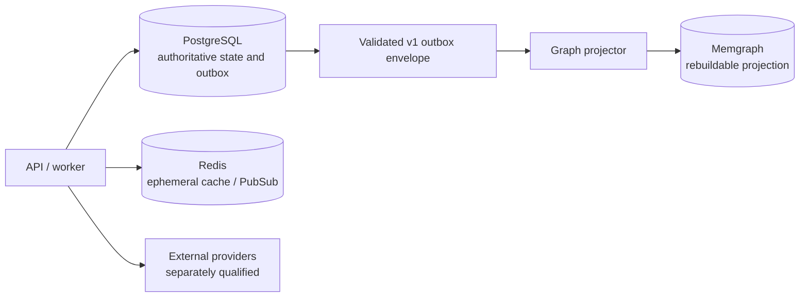

# VirgoScorpio Hub 0.6.2 — Full Release-Gate Report

**Report date:** 20 November 2026 (America/Chicago)
**Source repository:** [GoldenObsidianLLC/VirgoScorpio-Hub](https://github.com/GoldenObsidianLLC/VirgoScorpio-Hub)
**Authoritative merged baseline:** F1.58, main `619819230dac2e8d169ce71af7c6a41f0630cf27`
**Current maintainer candidate:** F1.59, PR [#232](https://github.com/GoldenObsidianLLC/VirgoScorpio-Hub/pull/232), head `623a5597553ffb783d5a42f9280acd40a06227d3`
**Release decision:** **PRODUCTION NO-GO — NOT_PRODUCTION_CERTIFIED**

> This report distinguishes exact-main release evidence from candidate branch evidence and independent production acceptance. Green CI, maintainer tests, signed attestations and a successful pull-request workflow do not constitute production certification or independent security approval.

## 1. Executive decision

VirgoScorpio Hub package **0.6.2 remains private, unreleased and not production-certified**. The canonical exact-main readiness artifact for F1.58 reports:

| Canonical readiness classification | Count |
|---|---:|
| PASS | 8 |
| PARTIAL | 2 |
| BLOCKED | 0 |
| MISSING_EVIDENCE | 14 |
| NOT_RUN | 0 |

The canonical artifact records `readyForProduction: false`, `releaseClassification: NOT_PRODUCTION_CERTIFIED`, and `decision: NO_GO`.

F1.59 is a bounded maintainer candidate that fixes a tenant/resource identity trust-boundary defect in graph projection. Its exact-head candidate workflows pass, but the change is not merged and has not received an independent approval. The candidate readiness artifact is a branch artifact; it does not supersede the exact-main readiness record.

**Release controls remain unchanged:** do not increment the package version, create a tag or GitHub Release, publish to npm, deploy to production, or make production-ready claims. Continue only within the documented isolated, non-production developer-preview boundary.

## 2. Exact-main baseline — F1.58

### 2.1 Merged source

F1.58 community-feed write authorization revalidation merged through [PR #228](https://github.com/GoldenObsidianLLC/VirgoScorpio-Hub/pull/228), closing [issue #227](https://github.com/GoldenObsidianLLC/VirgoScorpio-Hub/issues/227), at:

`619819230dac2e8d169ce71af7c6a41f0630cf27`

A live `git ls-remote` check confirmed that this remains the remote `refs/heads/main` revision at report time.

### 2.2 Exact-source workflow

Exact-main [workflow run #44675989750 (run number 820)](https://github.com/GoldenObsidianLLC/VirgoScorpio-Hub/actions/runs/44675989750) completed successfully on the exact main SHA. **All 7/7 jobs succeeded**:

| Job | Result |
|---|---|
| Unit, security and dependency checks — Node.js 22.23.4 | PASS — 670/670 Hub tests; 94/94 EnginEx tests |
| Unit, security and dependency checks — Node.js 24.22.1 | PASS — 670/670 Hub tests; 94/94 EnginEx tests |
| PostgreSQL and Memgraph integration | PASS — 180/180 live integration tests |
| Fresh and idempotent migrations | PASS — 18/18 applied; 18/18 skipped as already applied on second pass |
| Browser editor and accessibility smoke | PASS — 9/9 automated smoke tests |
| CodeQL security analysis | PASS |
| Dependency lockfile/SBOM attestation and evidence consolidation | PASS — signed provenance/SBOM verification and exact-source readiness finalization |

The live integration producer reported zero failures, skips or TODOs. The migration producer used a disposable database and reported its cleanup. The service-less integration diagnostic remains separately classified PARTIAL; its skips are not represented as live integration results.

### 2.3 Source-bound supply-chain evidence

The exact-main readiness artifact is #14601349640, generated at `2026-11-20T04:43:48.345Z`.

| Evidence item | Value |
|---|---|
| Readiness artifact archive SHA-256 | `bb1a62b74cc13ae495e6953d147d9e321fc8ee2bf7928545e5c3125abcbab746` |
| Finalized readiness JSON SHA-256 | `03ef7a8de44133ed6f0861187df9a68448d5e1d6ee59c6aa243deeac30b5ed49` |
| Consolidated CI evidence JSON SHA-256 | `5ee4b594d8873581ee78cd0925dacf5e6c5a24ac7d640b4107a36aaa77380ca6` |
| Supply-chain attestation artifact | #14602322573 |
| Supply-chain attestation artifact SHA-256 | `61ddee30dac33b49b500421d13704ef8a7af90db0685103a027bdc6b72cadfe3` |
| Committed package-lock.json SHA-256 | `8f3786bcfcd03d0b63761c7107e4d757ae5b45171ba2f6c086ff38c027c8b086` |
| CycloneDX 1.5 SBOM SHA-256 | `50aa80f1ee5475e0cd8095bc45e53009ec6b0dc571371a7a3db6e045dcbff14a` |

The mainline workflow verified signed provenance and SBOM subjects for the exact committed lockfile and generated SBOM. These automated checks do not replace the qualified human dependency/license/distribution review in issue #23.

## 3. F1.59 candidate — graph projection envelope identity

### 3.1 Scope and implementation

F1.59 is tracked by [issue #231](https://github.com/GoldenObsidianLLC/VirgoScorpio-Hub/issues/231), under umbrella [issue #124](https://github.com/GoldenObsidianLLC/VirgoScorpio-Hub/issues/124). The candidate branch is `security/f1-59-outbox-projection-envelope-scope-2026-11-20`; implementation commit `bf36d356913053df069abd825e157dad400a67d2`; consolidated PR [#232](https://github.com/GoldenObsidianLLC/VirgoScorpio-Hub/pull/232).

On exact F1.58 main, a validated PostgreSQL outbox envelope carried Site A while the duplicate `payload.siteId` value carried Site B. Before the fix, the graph projector used the payload identity in its Cypher parameters instead of treating the validated envelope as authoritative. This could redirect graph projection state across tenant/site boundaries.

The candidate:
- Reuses the shared v1 event-envelope validator and requires a valid envelope at the projector boundary.
- Rejects missing/invalid envelopes and mismatched event type, resource family, tenant site or aggregate identity before issuing a Memgraph write.
- Uses normalized canonical envelope identity for graph projection parameters.
- Preserves content business/editorial version separately from the aggregate projection version.
- Makes rebuild construct the same validated v1 envelope from canonical PostgreSQL repeatable-read snapshot rows; there is no payload-only projector fallback.
- Adds regressions for contradictory site/resource/event metadata, UUID case normalization, content/taxonomy/relationship projection and rebuild orchestration.

No schema, migration, HTTP/API, event-schema, dependency, lockfile, package-version or SemVer change was introduced.

### 3.2 Candidate local verification

| Validation | Result |
|---|---|
| Full local `npm run check` | 677 tests total; 674 passed, 0 failed, 3 conditional skips |
| Focused graph/outbox suite | 29 passed, 0 failed, 2 skipped locally because the required Memgraph service configuration was not enabled |
| Tenant-isolation inventory | Fresh: 28 families, 80 route patterns, 22 source files, 59 test references |
| Inventory source digest | `82f38c78ee897998e0774de688c36eef9f56e7217d26d6e807b7d35695fe1bd4` |
| Artifact verification and `git diff --check` | PASS |
| Markdown relative-link audit | 159 relative destinations checked across 10 changed Markdown files; 0 broken |

The three full-suite skips are conditional Windows/local environment skips. The two focused graph/outbox skips are the local service-dependent integration cases; neither is described as a passing live Memgraph test. Hosted integration supplies the service-backed validation.

### 3.3 Exact-head hosted candidate validation

The final candidate head is `623a5597553ffb783d5a42f9280acd40a06227d3`.

| Event | Workflow | Result |
|---|---|---|
| Branch push | [#44798684028 (run #827)](https://github.com/GoldenObsidianLLC/VirgoScorpio-Hub/actions/runs/44798684028) | Success |
| Pull request | [#44798692834 (run #828)](https://github.com/GoldenObsidianLLC/VirgoScorpio-Hub/actions/runs/44798692834) | Success |

Both events completed the six applicable functional jobs: Node 22 and 24 matrices, PostgreSQL/Memgraph integration, browser/accessibility smoke, CodeQL, and candidate evidence consolidation. Hosted Node matrices passed 677/677 Hub tests and 94/94 EnginEx tests per runtime; the live database integration passed 180/180; migrations passed 18/18 fresh and 18/18 idempotent; browser smoke passed 9/9. Both runs skipped `Attest dependency lockfile and SBOM` by design for feature-branch/PR events. That job is a post-merge mainline control and must not be configured as a PR-required context.

The exact-head push readiness artifact #14660651318 has archive SHA-256 `c932ee8bca3cdd8c427d40fd303203f6bfe3a2a7f008fbbf644c8931160779f6`. Its finalized readiness JSON SHA-256 is `d7238ea074f311be21b920592243fa1386de7f6b1e9df6fbc4f562cd90b5f7b8`; it is bound to branch head `623a5597553ffb783d5a42f9280acd40a06227d3` and records **8 PASS / 2 PARTIAL / 0 BLOCKED / 14 MISSING_EVIDENCE**, with production readiness false.

The PR-event readiness artifact #14660646349 is bound to GitHub's synthetic merge revision `1b4a2691378222b7127a0dacd2443cd2421c048c`, while recording the candidate branch head separately. It is supporting PR-event evidence, not an exact-main artifact.

### 3.4 Review and merge boundary

PR #232 is open, non-draft and reported mergeable. Its review decision is unset, no reviewer request is present, and GitHub records only a maintainer-authored `COMMENTED` review (not an approval); there are no inline review threads. **No independent non-author approval has been recorded.** Keep PR #232 open and unmerged until an authorized independent reviewer has inspected the final head and submitted an approving review.

The candidate does not advance the latest merged runtime. F1.58 remains the current merged runtime baseline until a reviewed F1.59 merge and subsequent exact-main validation occur.

## 4. Canonical production-evidence gate matrix

The following 14 evidence gates remain `MISSING_EVIDENCE` in the exact-main 0.6.2 readiness report. Issue closure is not evidence-gate closure: several issue tickets were closed after their original implementation tasks, but the separate evidence requirements remain unmet.

| # | Gate | Tracker / accountable function | Current evidence disposition and required closure |
|---:|---|---|---|
| 1 | `tenant-isolation-review` | [#14](https://github.com/GoldenObsidianLLC/VirgoScorpio-Hub/issues/14); independent tenant/security assessor | **OPEN / NOT PERFORMED.** Independent route/flow discovery and adversarial review of tenant boundaries, roles/capabilities, lifecycle races, workers, storage, events, caches and realtime delivery on a clean exact SHA; independent retest required. |
| 2 | `identity-provider-e2e` | #15; identity/SSO owner; scope decision in [#13](https://github.com/GoldenObsidianLLC/VirgoScorpio-Hub/issues/13) | **Evidence missing** (implementation issue closed). Validate the explicitly selected OIDC/SAML/email/MFA/recovery providers end to end, including issuer/audience/redirect/session and provider failure paths. |
| 3 | `clamav-corpus` | #16; media/file-security owner; scope decision in #13 | **Evidence missing** (implementation issue closed). Record scanner/version/topology and safe/malicious corpus results, unavailable/timeout failure behavior, quarantine and legacy `not_scanned` asset disposition. |
| 4 | `cloud-live-providers` | #17; cloud-storage owner; scope decision in #13 | **Evidence missing** (implementation issue closed). Prove enabled provider credentials, least-privilege CRUD/multipart, encryption, retention, rotation, outage and tenant isolation for each provider claimed. |
| 5 | `stripe-live-lifecycle` | #18; payments/billing owner; scope decision in #13 | **Evidence missing** (implementation issue closed). Dedicated Stripe test-mode lifecycle: checkout idempotency, signature and replay/out-of-order webhooks, ambiguous outcome recovery, refunds and subscription transitions. Stubs do not close it. |
| 6 | `browser-accessibility` | #19; QA/accessibility owner | **Evidence missing** (implementation issue closed). Automated Playwright 9/9 is smoke only. Manual keyboard/focus, screen reader, contrast, zoom/reflow and supported browser/OS/assistive-technology acceptance remain required. |
| 7 | `commerce-parity-acceptance` | #20; product/commerce owners | **Evidence missing** (implementation issue closed). Approve a bounded feature subset and end-to-end acceptance for tax/shipping/coupons, order lifecycle, fulfilment/downloads, refunds and recurring membership as applicable. |
| 8 | `community-parity-acceptance` | #21; product/community owners | **Evidence missing** (implementation issue closed). Approve the supported privacy/visibility, moderation/abuse/appeal, search, group/forum and export/deletion scenarios and user journeys. |
| 9 | `plugin-container-isolation` | #22; plugin runtime/security owner | **Evidence missing** (implementation issue closed). Prove signed artifact verification and adversarial execution isolation for egress, filesystem, secrets, syscalls, resources and host boundary; default execution remains disabled. |
| 10 | `dependency-sbom-codeql` | [#23](https://github.com/GoldenObsidianLLC/VirgoScorpio-Hub/issues/23); qualified supply-chain/license reviewer | **OPEN / PARTIAL.** Retain human-reviewed lockfile/transitive dependency inventory, SBOM/provenance digest verification, CodeQL disposition and qualified GPL/LGPL license/notice/distribution decision. Automated audit/signature success is not legal clearance. |
| 11 | `load-backup-restore` | [#24](https://github.com/GoldenObsidianLLC/VirgoScorpio-Hub/issues/24); database/platform operations and SRE/DR owners | **OPEN.** Define workload and recovery objectives before load/soak/fault tests; demonstrate PostgreSQL, graph and object-store backup/restore integrity, rollback and measured RPO/RTO. |
| 12 | `independent-security-review` | [#25](https://github.com/GoldenObsidianLLC/VirgoScorpio-Hub/issues/25); independent platform security assessor | **OPEN / NOT PERFORMED.** Separate platform-wide assessment with scope, threat model, method, exclusions, severity-ranked findings, remediation and independent retest or authorized risk disposition. |
| 13 | `operations-release-approval` | [#26](https://github.com/GoldenObsidianLLC/VirgoScorpio-Hub/issues/26); named operations/release owners | **OPEN.** Name accountable owners; approve topology; rehearse deploy/migrate/rollback/secret rotation/incident and recovery runbooks; obtain exact-SHA release-owner approval. |
| 14 | `observability-production` | Production observability owner; coordinated with #26 and governance #32 | **Evidence missing.** Approve telemetry backend, access/retention/data-classification, service ownership, alert routing, dashboards and tested incident response. Preview logs/console output are not production observability. |

### 4.1 The two PARTIAL classifications

1. **Reviewed lockfile:** `package-lock.json` is present and tracked, and fresh isolated `npm ci` succeeds. The human dependency, transitive package, license and distribution review remains open.
2. **Service-less integration diagnostic:** 47 tests per supported Node runtime; 1 passes and 46 are skipped without service configuration. This is honestly PARTIAL and is not the live integration result. The separately provisioned PostgreSQL/Memgraph/Redis producer passes 180/180 with zero skips.

## 5. Independent assurance, governance and repository controls

| Item | Current status | Boundary |
|---|---|---|
| Tenant isolation review #14 | OPEN / NOT PERFORMED | Maintainer-authored regressions and inventories do not satisfy independent review. |
| Platform security assessment #25 | OPEN / NOT PERFORMED | CodeQL and hosted CI do not constitute an independent platform assessment. |
| Dependency/license review #23 | OPEN / PARTIAL | Human GPL/LGPL and distribution review remains outstanding. |
| Release scope/provider matrix #13 | OPEN | The selected provider/product boundary has not been formally approved. |
| Load/backup/restore #24 | OPEN | No accepted environment-specific drill or RPO/RTO result. |
| Operations/release-owner approval #26 | OPEN | No named, rehearsed production operations/release acceptance. |
| Governance issue #32 | OPEN | A separate governance decision remains outstanding. |
| Main-branch governance #230 | OPEN | Main has no active ruleset and is not protected. |

The repository is a **user-owned GitHub repository**, not organization-owned; the owner account has no organization memberships. Team-specific required-reviewer assignment is therefore unavailable. A basic one-approval policy does not require moving the repository to an organization, but it does require at least one trusted, distinct direct collaborator with write permission. The direct collaborator listing currently contains only the owner. Do not use an owner's alternate identity or automation as a substitute for an independent reviewer.

When a trusted reviewer is onboarded, configure branch governance to require a non-author approval, dismiss stale approvals, require approval of the latest push, require resolved conversations and require the observed PR CI contexts:
- `Unit, security, and dependency checks (Node 22.23.4)`
- `Unit, security, and dependency checks (Node 24.22.1)`
- `PostgreSQL and Memgraph integration`
- `Browser editor and accessibility smoke tests`
- `CodeQL security analysis`
- `Consolidate candidate CI evidence`
- Separate GitHub Advanced Security `CodeQL` check, where exposed as its own required check.

Do **not** require the mainline-only `Attest dependency lockfile and SBOM` job on feature-branch/PR events; it is designed to run after merge on main.

## 6. Architecture and security posture

The current architecture boundary remains:

- PostgreSQL remains authoritative for tenant identity, membership, transactional domain state and outbox records.
- Memgraph is a derived, rebuildable relationship projection. It must not override canonical PostgreSQL identity.
- The validated outbox envelope is the identity boundary for graph projection; duplicate payload identity must be validated against it and may not redirect the projection.
- Redis presence/cache/PubSub remains ephemeral acceleration. Security-sensitive authorization must fail closed or revalidate against authoritative state.
- Authorization is enforced at final writes, not solely by preflight checks. Transactions use established deterministic lock ordering.
- Outages and rebuilds must preserve durable outbox replay semantics and canonical projection ordering.
- Provider, plugin, identity, payment, accessibility and deployment claims remain scoped to their own evidence, not inferred from adapter presence or unit tests.

## 7. Versioning and release restrictions

The root package remains version **0.6.2**, `private: true`. F1.59 changes no public API/schema, migration, dependency or package contract; no version increment is justified. Keep engineering increments and documentation reconciliation source-bound and separately reviewed.

No release tag, GitHub Release, npm publication, production deployment, production-data use, or production-ready marketing claim is authorized by this report. A successful exact-main CI workflow is a necessary source-quality control, not a release-owner decision.

## 8. Recommended next steps — ordered

1. **Resolve independent review access.** Identify one trusted, distinct GitHub account with write permission; onboard that reviewer and obtain formal approval on the latest F1.59 PR head. Until this happens, leave PR #232 open and unmerged.
2. **Complete governance issue #230.** Add non-author review and the exact PR-required CI contexts; keep mainline-only attestation outside pre-merge requirements. Verify the ruleset by running a documentation-only test PR.
3. **Implement the P2 outbox-consumer contract follow-up [issue #233](https://github.com/GoldenObsidianLLC/VirgoScorpio-Hub/issues/233).** The read-only audit found one active `createOutboxDeliveryWorker` registration—the graph consumer—already protected by F1.59. The generic callback still exposes raw payload and validated envelope side by side, so a future handler could misuse duplicated identity. Keep this separate from PR #232 and add shared, event-family-specific identity binding with no arbitrary recursive payload scanning.
4. **Obtain release-scope decisions under #13.** Name the exact supported providers, feature subset, deployment topology and accountable release authority before spending effort on provider-specific test work.
5. **Keep independent assurance and human supply-chain review explicit.** Arrange separately authorized tenant review #14, platform assessment #25 and qualified license/distribution review #23; do not reclassify maintainer evidence.
6. **Close the remaining operational and product evidence gates** with named owners and retained exact-SHA evidence. Keep production NO-GO until the canonical readiness process and release-owner decision both permit a different outcome.

## 9. Evidence provenance and interpretation

- **Merged mainline:** exact main SHA `619819230dac2e8d169ce71af7c6a41f0630cf27`; workflow run [#44675989750](https://github.com/GoldenObsidianLLC/VirgoScorpio-Hub/actions/runs/44675989750); readiness artifact #14601349640; signed supply-chain artifact #14602322573.
- **Candidate branch:** exact head `623a5597553ffb783d5a42f9280acd40a06227d3`; push run [#44798684028](https://github.com/GoldenObsidianLLC/VirgoScorpio-Hub/actions/runs/44798684028); PR run [#44798692834](https://github.com/GoldenObsidianLLC/VirgoScorpio-Hub/actions/runs/44798692834); exact-head readiness artifact #14660651318; PR-event artifact #14660646349.
- **Candidate implementation:** [F1.59 implementation report](2026-11-20-F1-59-OUTBOX-PROJECTION-ENVELOPE-SCOPE-REPORT.md), [issue #231](https://github.com/GoldenObsidianLLC/VirgoScorpio-Hub/issues/231) and [PR #232](https://github.com/GoldenObsidianLLC/VirgoScorpio-Hub/pull/232).
- **Authoritative machine readiness:** [RELEASE_READINESS.md](../RELEASE_READINESS.md) and [RELEASE-EVIDENCE.md](../RELEASE-EVIDENCE.md).

Historical reports retain their historical source SHAs and run IDs; they are not rewritten to imply later validation. This report is the current 20 November 2026 snapshot and must be superseded by a new source-bound report after a later merge or material gate disposition.
